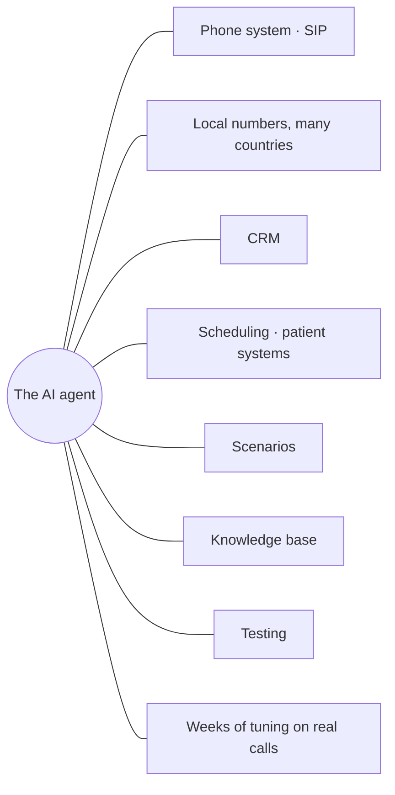
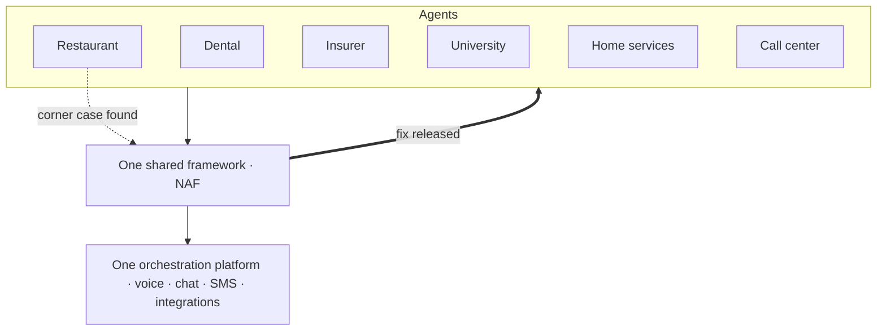
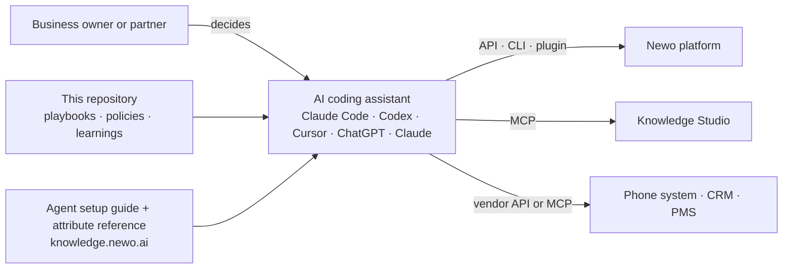
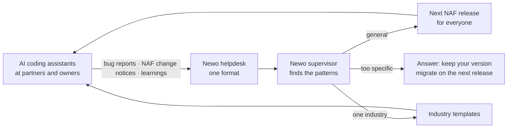

# How the ecosystem works

Read this first if you want the big picture: why this repository exists, how your work feeds
back into the Newo platform, and why the platform gets better with every agent.

## 1. The problem: deployment, not the demo

A voice agent demo takes minutes. A real deployment touches everything around the agent:

Across the industry this work has been done by forward-deployed engineers and solution architects.
There are few of them, they are expensive, and each one takes months to train.

## 2. One framework, every agent

Every Newo agent runs on one shared framework (NAF) on one orchestration platform. When one agent
meets a corner case and Newo fixes it in the framework, the fix reaches every agent.

That is accumulated process intelligence: corner cases from many industries and many calls, folded
into one framework. A small business's agent inherits the stability that larger deployments paid
for.

## 3. The harness: knowledge for AI engineers

AI coding assistants can now do the work of a forward-deployed engineer if they have the
knowledge. This repository gives them that knowledge, and the tools let them act on it.

## 4. The loop: from your ticket to everyone's release

What this means for you:
- **Report what you find** in the standard format ([support](support/README.md)). Every good
  report can improve every agent.
- **If you had to change NAF,** file the notice
  ([04-naf-change-policy.md](04-naf-change-policy.md)). Then wait for the decision: your change
  may come back to you as part of a release.
- **Share learnings** that other assistants should know ([learnings](../learnings/README.md)).

## 5. Why this knowledge is open

The playbooks and the agent code run only on the Newo platform: its events, commands and
integrations. Publishing the knowledge brings more agents onto the platform, and every agent makes
it more reliable for all the others.

## Status (November 2026)

| Piece | Status |
|---|---|
| This repository, the agent setup guide, the attribute reference | live |
| Newo plugin for ChatGPT and Claude (create and configure agents from a chat) | live |
| Newo CLI with V2 support, sandbox and scripted tests | live |
| Knowledge Studio and its MCP server | live, rolling out |
| A ticket tool for coding assistants | planned |
| A safe test copy of an agent | planned |
| Listing in the ChatGPT and Claude app directories | planned |
| Automated quality assessment built into the platform | planned |
